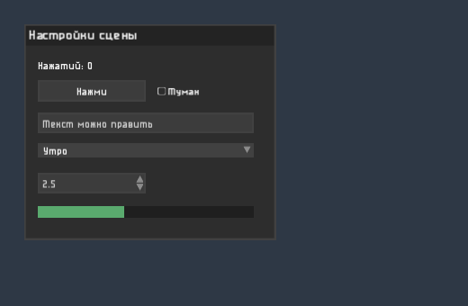

# VisorGUI

Object-oriented GUI library that overlays OpenGL games and apps on SDL2: retained widgets instead of ImGui-style immediate mode, FreeType text, fully custom look.



Status: in active use in a voxel engine and its model editor, API may still change.

## What it is

- Widgets are objects: you create a window, put buttons, fields and lists into it, subscribe to their events and forget about them. Each widget draws itself into its own texture only when something changed, so a static interface costs one textured quad per widget per frame.
- Made to sit on top of your own rendering: debug windows over a game, in-game menus, tool panels. Several `GuiEngine` layers can be stacked, popups and tooltips can be drawn after all of them.
- Layout is in pixels of a 1920x1080 screen and scales with the window.
- Widgets: window with scroll and drag (`ScrollAreaWidget`), `Button`, `SwitchButton`, `CheckBox`, `Label`, `LineEdit`, `ValueEdit` (wheel and drag), `Vec2LineEdit`, `Vec3LineEdit`, `ComboBox`, `PopupMenu`, `MenuBar`, `Slider`, `ProgressBar`, `Spoiler`, `VerticalLayout`, `FrameBox`, `ColorPicker`, `ColorSwatch`, `FolderBrowser`, `Chart`, `Console`, `ToolTip`.

Code comments are in Russian.

## Requirements

C++20, SDL2, FreeType, glm, an OpenGL 3.3 loader (GLEW by default, another one via `-DVGUI_GL_HEADER="<glad/glad.h>"`). stb_image is bundled; if your program already compiles its implementation, define `VGUI_NO_STB_IMAGE_IMPLEMENTATION`.

## Building

Put the library into a folder named `VisorGUI` (headers are included as `<VisorGUI/...>`) and add it from your CMake:

```cmake
set(VGUI_DEPENDENCY_INCLUDE_DIRS ${SDL2_INCLUDE_DIRS} ${FREETYPE_INCLUDE_DIRS} path/to/glm path/to/glew/include)
add_subdirectory(Libs/VisorGUI)
target_link_libraries(MyProgram PRIVATE VisorGUI SDL2 freetype GLEW OpenGL)
```

`-DVGUI_BUILD_EXAMPLE=ON` builds `Example/main.cpp`.

## Minimal program

```cpp
#include <VisorGUI/vgui.h>

vgui::GuiEngine gui(window);  // after the OpenGL context is created

auto *panel = new vgui::ScrollAreaWidget(vgui::MySize<double>(420, 300), glm::dvec2(40, 40),
                                         {vgui::FIXED_SIZE, vgui::FIXED_SIZE},
                                         {vgui::ABSOLUTE_WINDOW_POSITION, vgui::ABSOLUTE_WINDOW_POSITION},
                                         glm::dvec2(0, 0), L"Window");
gui.addGuiObject(panel);

auto *button = new vgui::Button(vgui::MySize<double>(180, 36), glm::dvec2(20, 20),
                                {vgui::FIXED_SIZE, vgui::FIXED_SIZE},
                                {vgui::ABSOLUTE_PARENT_POSITION, vgui::ABSOLUTE_PARENT_POSITION},
                                glm::dvec2(0, 0), L"Press");
panel->addChild(button);
button->eventManager().subscribe<vgui::Button::Click_Event>(&gui, [](const vgui::Button::Click_Event &) {
    // ...
});

// In the main loop:
//   gui.handleEvent(event) for every SDL event (true - the interface took it)
//   gui.render() after your scene
```

## Hooks

`vgui::platform()` holds what the library takes from the program, all optional: `loadResource` (fonts and images by name, by default a file path or the library's own `Resources`), `cursorPosition`, `requestCursor` / `applyCursor` (mouse cursor shape), `log`. Set them before creating the first `GuiEngine`.

## Fonts

The default font is Covid19 by Peter Wiegel, distributed under SIL Open Font License / GPL with font exception (see `Resources/Fonts/README.md`).

## License

MIT, see `LICENSE`.
